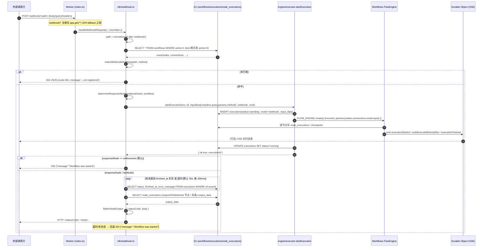
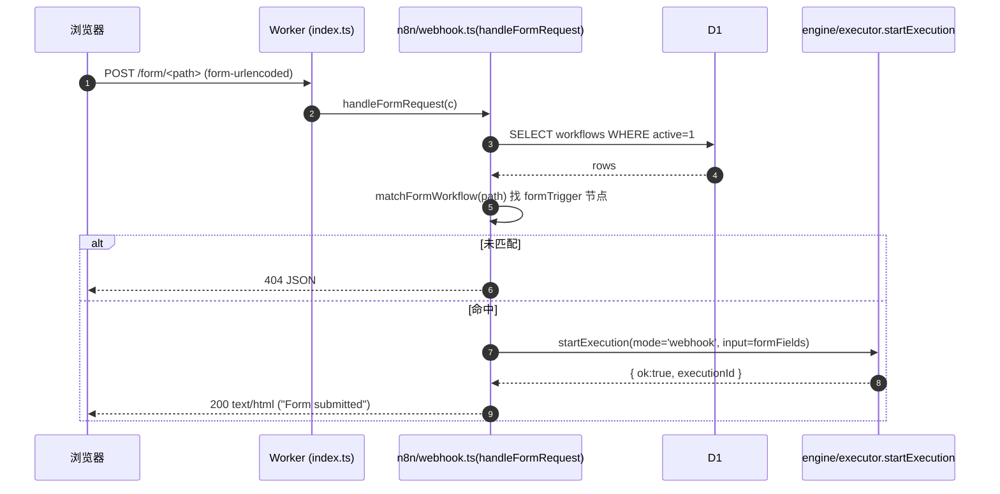
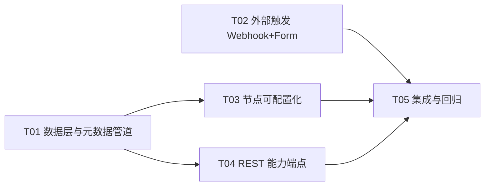

# mini-flow 增量设计（Design-Increment）

- **Language**: 中文
- **Programming Language**: TypeScript（后端 Hono + Cloudflare Workers）；前端 100% 复用 n8n editor-ui dist（不改源码）
- **Project Name**: mini_flow
- **文档性质**: 增量设计（在既有骨架与已修复基线上补齐 10 项能力；只描述「变更」，不重写整份架构）
- **上游输入**: `01-prd-increment.md`、`DECISIONS.md`、`README.md`
- **核对基线（本设计撰写时实测）**: `node scripts/run-tests.mjs` → **57 passed / 0 failed**；`tsc --noEmit` 零错误；本地预览 `http://127.0.0.1:8787` 上 `/webhook/<p>`、`/form/<p>` 均返回 **200 `text/html`**（即 SPA fallback，证实 REQ-14/REQ-31），`/rest/insights/*` 已登录后落 `.all('*')` 404。

---

## 0. 本轮范围与关键修正

### 0.1 本轮实现（10 项）

| REQ | 优先级 | 一句话 |
| --- | --- | --- |
| REQ-14 | P0 | 外部 Webhook 触发路由落地（`/webhook/:path`） |
| REQ-11 | P1 | HTTP 节点非 2xx 默认失败 |
| REQ-15 | P1 | `POST /rest/executions/:id/retry`（新建 execution + `retryOf`） |
| REQ-16 | P1 | 节点 `properties` 参数面板补全 |
| REQ-31 | P2 | Form 触发器外部路由（`/form/:path`，与 REQ-14 同机制） |
| REQ-17 | P2 | 节点 `credentials` 声明 |
| REQ-26 | P2 | `/rest/insights/*` 端点 |
| REQ-27 | P2 | `/rest/tags` CRUD |
| REQ-29 | P2 | 工作流导入 / 导出 |
| REQ-32 | P2 | 社区节点安装 / 卸载端点 |

### 0.2 Non-Goals（本轮明确不做）

- **REQ-18**：不扩节点数量（保持 **68** 个已注册节点），只把已注册节点做「可配置」。补齐的是 REQ-16 的 `properties`，不是新节点。
- **REQ-19**：Code/Function 节点保持「受限表达式求值器」，**不实现任意 JS**，**不引入 `eval`/`new Function`**（Workers CSP 硬约束）。本设计只在 Code 节点 `properties`/`description` 里写明边界。
- **REQ-39**：不做多租户 / 多用户隔离，维持单 owner 实例。
- **REQ-35~38**：属界面行为，由 team-lead 在阶段 5 用真实预览复测，不进本轮实现范围。
- **REQ-05 凭据落库加密**：本轮不做（保持 KV 明文 + 出站脱敏），列为遗留风险（见 §7）。
- **不魔改 `frontend/dist`**：新增能力只能通过后端契约 / 节点元数据适配。

### 0.3 ⚠️ 对 PRD 数据的两处修正（以服务端实际输出为准）

**修正 1 —— 节点 `properties` 计数（PRD 说 33 有 / 35 空；实测 31 有 / 37 空）**

实测来源链：`src/plugins/builtin.ts` 的 `def(...)` 工厂 → `src/plugins/registry.ts` `allNodeTypeDefs()` → `src/n8n/node-types.ts` `nodeTypeDefs()`，对 `GET /rest/node-types` 的输出直接计数：

```
TOTAL: 68   WITH_PROPS: 31   EMPTY: 37
```

`grep -c "def({" = 68`（节点数对）；`grep -c "properties:" = 33`，其中 **2 个是显式空数组 `properties: []` 或不产生非空 properties 的写法**，故「有参数」实为 **31**。以 **31 / 37** 为准。

**修正 2 —— 37 个空参数节点的准确分组**

- **A. 必须补参数（33 个）** —— 这些节点要么是动作/转换节点（用户必须能配），要么是占位/需凭据节点：
  - Flow/逻辑：`switch`、`merge`、`splitInBatches`、`delay`、`filter`、`sort`、`aggregate`、`removeDuplicates`、`outputNode`
  - 数据/字段：`set`、`editFields`、`renameKeys`、`assign`、`extractFromFile`、`textSplitter`、`math`、`dateTime`
  - 文本：`textCase`、`textCount`
  - 触发器/回包：`formTrigger`、`intervalTrigger`、`respondToWebhook`
  - 受限求值：`function`
  - DB 占位：`mySql`、`postgres`、`sqlite`
  - AI 占位：`embeddings`、`huggingFace`
  - 通讯占位：`sendgrid`、`email`、`slack`、`telegram`、`discord`
- **B. 触发器/装饰可合法无参数（4 个）**：`manualTrigger`、`errorTrigger`、`stickyNote`、`noOp`。
  - 为让 REQ-16 验收「每个节点 `properties` 非空」**字面成立**，推荐给这 4 个各加一个**只读 `notice` 属性**（`type: 'notice'`，无交互、无副作用），从而 68/68 全部非空；若团队接受「触发器/装饰豁免」，则最小实现为仅补 A 组 33 个。

**修正 3 —— `respondToWebhook` 的 group 语义**：该节点当前 `group: ['trigger']`，但本质是「动作/响应」节点。REQ-14 的回包逻辑依赖它，本设计不改其 group（避免前端面板归类回归），仅在 `properties` 上补 `respondWith`/`responseCode`。

---

## Part A：系统设计

### 1. 实现方案

#### REQ-14 · 外部 Webhook 触发路由

**问题**：`/webhook/:path` 现落 `index.ts` 的 `app.get('*')` SPA fallback，返回 `index.html`（实测 200 `text/html`）。

**方案**：新增 `src/n8n/webhook.ts`，导出 `handleWebhookRequest(c, { test })`；在 `src/index.ts` 中**于 `app.get('*')` 之前**注册 `/webhook/*` 与 `/webhook-test/*`。

- **匹配**：`matchWebhookWorkflow(env, path, method, { test })`
  - 查询：`test=false` → `SELECT ... FROM workflows WHERE active=1`；`test=true` → `WHERE active=0`（对齐 n8n 测试 URL 只对未激活工作流生效）。
  - 逐条 `JSON.parse(nodes)`，找**启用中**、`type` 命中 `/webhook/i` 且**排除** `/respondToWebhook|webhookSend/i`、且 `parameters.path` 归一化后等于请求 path 的节点；若节点 `parameters.httpMethod` 有值且与请求 method 不符则跳过。
  - path 归一化：两侧去首尾 `/` 与 URL 解码后比较。
  - 命中返回 `{ workflow: N8nWorkflow, webhookNode: N8nNode }`；否则 `null`。
- **触发响应语义（对齐拍板）**：`determineResponseMode(workflow, webhookNode)`
  1. `webhookNode.parameters.responseMode`（或 `parameters.options.responseMode`）为 `'lastNode'` → `lastNode`；
  2. 为 `'responseNode'` → `responseNode`；
  3. 工作流含启用的 `/respondToWebhook/` 节点 → `responseNode`；
  4. 否则 `onReceived`（默认）。
- **执行**：`startExecution(env, workflow, input, 'webhook', (e) => void sendPush(env, e))`。`input` 组装为 n8n 风格 `{ body, headers, query, params, method }`。
- **返回**：
  - `onReceived` → 立即 `200 {"message":"Workflow was started"}`。
  - `responseNode` / `lastNode` → `waitForExecutionResponse(...)` 轮询 D1 至完成或超时，取回包/末节点输出，按输出体 + 状态码返回；超时/失败回退 `200 {"message":"Workflow was started"}`。
  - **未匹配 → 404 JSON**（`{code:404,message:'The requested webhook "<METHOD> <path>" is not registered.'}`），**不得落 SPA fallback**。
  - workflow 存在但执行提交失败 → `409 JSON`。

> 说明：`/webhook-test/:path` 与主路由同机制，仅匹配 `active=0`。实现成本很低（复用同一函数），**本轮一并实现**（不降级为「只做 `/webhook/:path`」）。

#### REQ-31 · Form 触发器外部路由

**方案**：同一 `src/n8n/webhook.ts` 导出 `handleFormRequest(c)`；`src/index.ts` 注册 `/form/*`。

- 匹配 `matchFormWorkflow(env, path)`：找启用、`type` 命中 `/formTrigger|form_trigger|node\.form/i`、`parameters.path` 命中的**已激活**工作流；命中不到 → **404 JSON**。
- `GET /form/:path` → 依据 `formTrigger` 节点 `parameters.formFields`（若有）生成极简 HTML 表单，否则返回含单个 `data` 文本域的通用表单；`Content-Type: text/html`。
- `POST /form/:path` → 解析 `application/x-www-form-urlencoded` 或 JSON body，`startExecution(mode='webhook')`，返回极简 `200 text/html`（"Form submitted"）；若 `Accept: application/json` 则返回 `{data:{executionId}}`。

#### REQ-11 · HTTP 节点非 2xx 默认失败

**文件**：`src/nodes/http-request.ts`。

**现状**：`alwaysFailOnError` 默认 false → 非 2xx 也返回数据（实测语义仍存在）。

**改法**：翻转默认值 —— **默认对非 2xx 抛错**；仅当节点显式开启「忽略 HTTP 状态错误/失败续跑」时返回数据。

```
const ignore = p.options?.ignoreHttpStatusErrors === true
  || p.options?.alwaysFailOnError === false
  || p.ignoreHttpStatusErrors === true
  || p.continueOnFail === true;
if (!res.ok && !ignore) throw new Error(`HTTP ${res.status} ...`);
```

- 网络层错误（DNS/拒绝/超时）继续无条件抛错（既有 REQ-10，不变）。
- 在 `builtin.ts` 的 `httpRequest` 节点补 `ignoreHttpStatusErrors`（boolean，默认 false）参数，并同步 `node-types.ts` 的 `jsonSchemaFor`。

#### REQ-15 · 执行 retry

**文件**：`src/n8n/executions.ts`（新增 `POST /:id/retry`）；`schema.sql` + `src/db/schema.ts`（新增列）。

**语义（对齐拍板）**：**新建 execution**，在其记录写 `retry_of = 原 executionId`；不原地续跑。复用 `src/engine/dead-letter.ts::rebuildFromDlq` 的「建 execution → FLOW_ENGINE.create → 置 running」重建范式，但以**原执行**为输入源。

- 查原 execution（无 → 404），查其 workflow（无 → 404）。
- `newId = crypto.randomUUID()`；`INSERT INTO executions (id, workflow_id, status, trigger_type, mode, input_data, retry_of, started_at) VALUES (newId, wf, 'pending','retry', orig.mode, orig.input_data, origId, datetime('now'))`。
- `await FLOW_ENGINE.create({ id:newId, params:{ workflowId, workflowName, nodes, connections, executionId:newId, mode: orig.mode ?? 'manual', input: JSON.parse(orig.input_data ?? '{}'), completedNodes: [] } })`。
- `UPDATE executions SET status='running' WHERE id=newId`；`sendPush(executionStarted)`。
- 返回 `{ data: { executionId: newId, id: newId, workflowId, status:'running', retryOf: origId } }`。
- 同时把列表/详情里硬编码的 `retryOf: null` 改为读 `r.retry_of ?? null`；`retry_success_id` 列留给后续「重试成功回写原执行」，本轮只建列不写。

#### REQ-16 · 节点 `properties` 补全

**文件**：`src/plugins/builtin.ts`（仅补 `properties`，不新增节点）。

按 §6 表格给 33 个节点补参数面板；参数 `name` **必须与对应执行器读取的 key 对齐**（见 §6「执行器读取键」列），否则面板可填但不生效。给 §0.3 修正 2 的 4 个合法空节点补 `notice`（推荐）。

#### REQ-17 · 节点 `credentials` 声明

**文件**：`src/plugins/builtin.ts`、`src/plugins/types.ts`、`src/n8n/node-types.ts`、`src/n8n/credentials.ts`。

- `PluginNodeType` 与 `MiniNodeType` 增加可选字段：`credentials?: Array<{ name: string; required?: boolean; displayOptions?: unknown }>`。
- `def(...)` 透传 `credentials` 到节点元数据（当前 `def()` 丢弃未列出的字段，需显式加）。
- 给需鉴权节点声明（`name` 必须存在于 `credentialTypes()`，否则 NDV 选不到）：
  - `openAi` → `openAiApi`（required）
  - `huggingFace` → `huggingFaceApi`（required）
  - `embeddings` → `openAiApi`
  - `httpRequest` → `httpHeaderAuth` / `httpBasicAuth` / `httpQueryAuth`（可选）
  - `telegram` → `telegramApi`、`slack` → `slackApi`、`discord` → `discordApi`、`sendgrid` → `sendGridApi`、`email` → `smtp`、`mySql` → `mySql`、`postgres` → `postgres`
- `src/n8n/credentials.ts::credentialTypes()` 补齐上述缺失类型（`telegramApi`/`slackApi`/`discordApi`/`sendGridApi`/`smtp`/`mySql`/`postgres`），每个给出 `properties`（如 token / password 字段）。
- 运行时读取凭据不在本轮范围（占位节点仍走 `notifyPlaceholderNode`/`dbPlaceholderNode`）；本轮只保证「NDV 能选到凭据」这一元数据闭环。

#### REQ-26 · `/rest/insights/*`

**文件**：新增 `src/n8n/insights.ts`；`src/n8n/router.ts` 挂载。

- `GET /rest/insights/summary?startDate&endDate` → `{ data: { total, failed, failureRate, averageRunTime, timeSaved } }`，由 D1 聚合 `executions`（`COUNT(*)`、`SUM(status='failed')`、`AVG(finished_at-started_at)`）得出。
- `GET /rest/insights/by-workflow` → `{ data: [ { workflowId, workflowName, total, failed, failureRate, averageRunTime } ] }`（`GROUP BY workflow_id`）。
- `GET /rest/insights/by-time?granularity=day|hour` → `{ data: [{ date, total, failed }] }`。
- `GET /rest/insights/by-mode` → `{ data: [{ mode, total, failed }] }`。
- 全部经全局鉴权墙（放在 `restApi` 内，落墙后），非法参数不 500。

#### REQ-27 · `/rest/tags` CRUD

**文件**：新增 `src/n8n/tags.ts`；`src/n8n/router.ts` 挂载；`schema.sql` + `src/db/schema.ts` 建表。

- `GET /rest/tags` → `{ data: [{ id, name, createdAt, updatedAt }] }`。
- `POST /rest/tags { name }` → 201 `{ data: tag }`；重名 → 409。
- `PATCH /rest/tags/:id { name }` → `{ data: tag }`；不存在 → 404。
- `DELETE /rest/tags/:id` → `{ data: true }`（级联删 `workflow_tags`）。
- 替换 router 里现有 `.get('/tags', (c) => c.json({ data: [] }))`（迁移期空表仍返回 `[]`，不破坏现状）。

#### REQ-29 · 工作流导入 / 导出

**文件**：`src/n8n/workflows.ts`（新增两条路由）。

- `GET /rest/workflows/:id/export` → 200 `application/json`，body 为 n8n 原生工作流对象（`{ id, name, nodes, connections, settings, active, versionId }`），响应头 `Content-Disposition: attachment; filename="<name>.json"`；不存在 → 404 JSON。
- `POST /rest/workflows/import`：body 兼容三种形态（裸 workflow / `{workflow}` / `{data}`）；若 `id` 缺失或已存在则重新分配 `crypto.randomUUID()`；走既有 upsert 落库；返回 201 `{ data: workflow }`。
- **注册顺序**：`POST /import` 需在 `GET /:id`、`PUT/PATCH /:id` 之前注册（避免被 `/:id` 误捕）；Hono 按「段数 + 方法」匹配，`/:id/export`（2 段）与 `/:id`（1 段）不冲突，但为稳妥仍按「具体路径在前」排列。

#### REQ-32 · 社区节点安装 / 卸载

**文件**：新增 `src/n8n/community-nodes.ts`；`src/n8n/router.ts` 挂载；`schema.sql` 建 `community_nodes` 表。

- `GET /rest/community-nodes` → `{ data: [ {...installed} ] }`。
- `POST /rest/community-nodes { name, version?, displayName?, description?, nodes? }` → 201 `{ data: {...} }`；同 `name` 重复 → 409；`name` 为空 → 400。
- `POST /rest/community-nodes/:name/uninstall` → `{ data: true }`；不存在 → 404。
- `GET /rest/plugins`（router 内）改为**合并**：`listPlugins()`（内置，`isCommunity:false`）+ 从 `community_nodes` 读取的社区包（`isCommunity:true`，`nodeCount` 取 `nodes_json.length`）。这样「安装后可在 `/rest/plugins` 看到」成立。
- **重要边界**：Workers 无法真正加载/执行任意 npm 包，本轮为**元数据级安装登记**（与既有占位语义一致），不执行外部代码；在设计中明示。

---

### 2. 文件清单（相对路径）

**新增文件**

| 文件 | 说明 |
| --- | --- |
| `src/n8n/webhook.ts` | 外部触发（webhook + form）匹配/触发/响应收集 |
| `src/n8n/insights.ts` | `/rest/insights/*` 聚合端点 |
| `src/n8n/tags.ts` | `/rest/tags` CRUD |
| `src/n8n/community-nodes.ts` | 社区节点安装/卸载 + 目录 |
| `tests/integration/webhook.test.ts` | Webhook/Form 集成测试（新增） |
| `tests/integration/rest-increment.test.ts` | retry/insights/tags/import-export/community 集成测试（新增） |
| `tests/unit/http-request.test.ts` | HTTP 节点非 2xx 默认失败单测（新增） |
| `migrations/increment-01.sql` | **仅对已部署 D1** 的增量 DDL（`ALTER TABLE`；schema.sql 已含新列，勿重复执行） |

**修改文件**

| 文件 | 改动 |
| --- | --- |
| `src/index.ts` | 注册 `/webhook/*`、`/webhook-test/*`、`/form/*`（**在 `app.get('*')` 之前**） |
| `src/n8n/router.ts` | 挂载 insights/tags/community-nodes 路由（**在 `.all('*')` 之前**）；`/plugins` 合并社区包 |
| `src/n8n/executions.ts` | 新增 `POST /:id/retry`；`retryOf` 读 `retry_of` 列 |
| `src/n8n/workflows.ts` | 新增 `GET /:id/export`、`POST /import` |
| `src/n8n/settings.ts` | **核对不改**：`urlBaseWebhook`/`endpointForm`/`endpointWebhook`/`endpointWebhookTest` 已存在（§5 说明） |
| `src/n8n/credentials.ts` | `credentialTypes()` 补 telegram/slack/discord/sendgrid/smtp/mysql/postgres |
| `src/n8n/node-types.ts` | `MiniNodeType` 加 `credentials?`；`jsonSchemaFor` 补新参数 |
| `src/plugins/types.ts` | `PluginNodeType` 加 `credentials?` |
| `src/plugins/builtin.ts` | `def()` 透传 `credentials`；补 33 个节点 `properties`；4 个 notice；节点 `credentials` 声明；httpRequest 补 `ignoreHttpStatusErrors` |
| `src/nodes/http-request.ts` | 非 2xx 默认抛错 |
| `schema.sql` | executions 加 `retry_of`/`retry_success_id`；新增 `tags`/`workflow_tags`/`community_nodes` 表 |
| `src/db/schema.ts` | `ExecutionRow` 加 `retry_of`/`retry_success_id`；新增 `TagRow`/`CommunityNodeRow` 类型 |
| `frontend/dist/types/nodes.json` | 由 `npm run gen:nodes` **重新生成**（构建产物，随 predeploy 同步） |

---

### 3. 接口与数据结构

#### 3.1 新增/变更端点契约

> 统一约定：成功 `{ data }` 包裹；错误 `{ code, message, data: undefined }` + 对应 HTTP 状态。

**A. 外部触发（`src/index.ts` 直挂，绕开 `/rest` 鉴权墙）**

| Method | Path | 请求 | 响应 | 状态码 |
| --- | --- | --- | --- | --- |
| ALL | `/webhook/:path`（含子路径） | 任意 body/query/header | 见 REQ-14 三态 | 200 / 404 / 409 |
| ALL | `/webhook-test/:path` | 同上（仅对 `active=0`） | 同上 | 200 / 404 / 409 |
| GET | `/form/:path` | — | HTML 表单 | 200 / 404 |
| POST | `/form/:path` | form-urlencoded 或 JSON | HTML 或 `{data:{executionId}}` | 200 / 404 |

Webhook 未匹配示例响应体：
```json
{ "code": 404, "message": "The requested webhook \"POST foo\" is not registered.", "data": undefined }
```
onReceived 默认响应体：
```json
{ "message": "Workflow was started" }
```
responseNode 响应体（取 `respondToWebhook` 节点输出，状态码取其 `responseCode`，默认 200）：节点输出 `main[0][0].json` → 若单条则直接该对象，多条则数组。

**B. `/rest/*`（在全局鉴权墙之后）**

| Method | Path | 请求 | 响应 | 状态码 |
| --- | --- | --- | --- | --- |
| POST | `/rest/executions/:id/retry` | `{ loadWorkflow?: boolean }`（可空） | `{ data: { executionId, id, workflowId, status:'running', retryOf } }` | 200 / 404 |
| GET | `/rest/insights/summary` | `?startDate&endDate` | `{ data: { total, failed, failureRate, averageRunTime, timeSaved } }` | 200 |
| GET | `/rest/insights/by-workflow` | `?startDate&endDate` | `{ data: [{ workflowId, workflowName, total, failed, failureRate, averageRunTime }] }` | 200 |
| GET | `/rest/insights/by-time` | `?granularity=day\|hour` | `{ data: [{ date, total, failed }] }` | 200 |
| GET | `/rest/insights/by-mode` | — | `{ data: [{ mode, total, failed }] }` | 200 |
| GET | `/rest/tags` | — | `{ data: [{ id, name, createdAt, updatedAt }] }` | 200 |
| POST | `/rest/tags` | `{ name }` | `{ data: { id, name, createdAt, updatedAt } }` | 201 / 400 / 409 |
| PATCH | `/rest/tags/:id` | `{ name }` | `{ data: tag }` | 200 / 404 |
| DELETE | `/rest/tags/:id` | — | `{ data: true }` | 200 |
| GET | `/rest/workflows/:id/export` | — | n8n 工作流 JSON（`Content-Disposition: attachment`） | 200 / 404 |
| POST | `/rest/workflows/import` | workflow / `{workflow}` / `{data}` | `{ data: workflow }` | 201 |
| GET | `/rest/community-nodes` | — | `{ data: [ {...} ] }` | 200 |
| POST | `/rest/community-nodes` | `{ name, version?, displayName?, description?, nodes? }` | `{ data: {...} }` | 201 / 400 / 409 |
| POST | `/rest/community-nodes/:name/uninstall` | — | `{ data: true }` | 200 / 404 |
| GET | `/rest/plugins`（改） | — | `{ data: [内置..., 社区...] }` | 200 |
| GET | `/rest/node-types`（改） | — | 每项含非空 `properties` + 可选 `credentials` | 200 |

#### 3.2 DDL 变更（`schema.sql`）

> D1 = SQLite 语法。**新装**：下列定义直接进入 `schema.sql` 的 `CREATE TABLE`。**已部署库**：另建 `migrations/increment-01.sql`（见文件清单）用 `ALTER TABLE` 补齐，且**不得**再于同一库重复执行含新列的 `CREATE TABLE`。

```sql
-- 1) executions 扩展（重试关联）——写入 CREATE TABLE，并追加 ALTER 迁移
--    retry_of          : 本执行由哪个 execution 重试而来（REQ-15）
--    retry_success_id  : 本执行被重试且成功的后继 executionId（本轮只建列）
ALTER TABLE executions ADD COLUMN retry_of TEXT;
ALTER TABLE executions ADD COLUMN retry_success_id TEXT;
-- 索引（可选，加速按来源查询）
CREATE INDEX IF NOT EXISTS idx_executions_retry_of ON executions(retry_of);

-- 2) 标签（REQ-27）
CREATE TABLE IF NOT EXISTS tags (
  id         TEXT PRIMARY KEY DEFAULT (lower(hex(randomblob(16)))),
  name       TEXT NOT NULL UNIQUE,
  created_at TEXT NOT NULL DEFAULT (datetime('now')),
  updated_at TEXT NOT NULL DEFAULT (datetime('now'))
);
CREATE TABLE IF NOT EXISTS workflow_tags (
  workflow_id TEXT NOT NULL,
  tag_id      TEXT NOT NULL,
  PRIMARY KEY (workflow_id, tag_id),
  FOREIGN KEY (workflow_id) REFERENCES workflows(id),
  FOREIGN KEY (tag_id) REFERENCES tags(id)
);
CREATE INDEX IF NOT EXISTS idx_workflow_tags_tag ON workflow_tags(tag_id);

-- 3) 社区节点安装登记（REQ-32；元数据级，不执行外部代码）
CREATE TABLE IF NOT EXISTS community_nodes (
  id           TEXT PRIMARY KEY DEFAULT (lower(hex(randomblob(16)))),
  name         TEXT NOT NULL UNIQUE,      -- npm 包名
  display_name TEXT,
  version      TEXT,
  description  TEXT,
  nodes_json   TEXT,                      -- JSON: 该包声明的节点元数据（可为 []）
  installed_at TEXT NOT NULL DEFAULT (datetime('now'))
);
```

> `CREATE TABLE workflows/executions` 的**新装定义**需把 `retry_of`/`retry_success_id` 直接写进 `executions` 的列定义中（测试用 `schema.sql` 建库，不会跑 ALTER）。因此 `schema.sql` 里 executions 的最终列定义应包含这两列；`migrations/increment-01.sql` 仅服务于**已建库**的本地/线上环境。

#### 3.3 `src/db/schema.ts` 类型变更

```ts
export interface ExecutionRow {
  // ...既有字段...
  retry_of: string | null;          // 新增
  retry_success_id: string | null;  // 新增
}

export interface TagRow {
  id: string; name: string; created_at: string; updated_at: string;
}

export interface CommunityNodeRow {
  id: string; name: string; display_name: string | null; version: string | null;
  description: string | null; nodes_json: string | null; installed_at: string;
}
```

#### 3.4 节点元数据类型变更

```ts
// plugins/types.ts 与 n8n/node-types.ts 同步新增
export interface NodeCredentialRef {
  name: string;              // 必须存在于 credentials.ts 的 credentialTypes().name
  required?: boolean;
  displayOptions?: unknown;
}
// PluginNodeType / MiniNodeType 增加：
credentials?: NodeCredentialRef[];
```

`def(...)` 的 partial 增加 `credentials?: NodeCredentialRef[]`，并在返回对象里透传（当前 `def()` 只挑选已知字段，需补）。

#### 3.5 Webhook 关键函数签名（`src/n8n/webhook.ts`）

```ts
export async function handleWebhookRequest(
  c: Context<{ Bindings: Env }>, opts: { test: boolean },
): Promise<Response>;

export async function handleFormRequest(c: Context<{ Bindings: Env }>): Promise<Response>;

export async function matchWebhookWorkflow(
  env: Env, path: string, method: string, opts: { test: boolean },
): Promise<{ workflow: N8nWorkflow; webhookNode: N8nNode } | null>;

export async function matchFormWorkflow(
  env: Env, path: string,
): Promise<{ workflow: N8nWorkflow; formNode: N8nNode } | null>;

export type ResponseMode = 'onReceived' | 'lastNode' | 'responseNode';
export function determineResponseMode(workflow: N8nWorkflow, webhookNode: N8nNode): ResponseMode;

export async function waitForExecutionResponse(
  env: Env, executionId: string, mode: ResponseMode, timeoutMs?: number,
): Promise<{ statusCode: number; body: unknown } | null>;

export function flattenNodeOutput(outputData: string | null): unknown;
```

`waitForExecutionResponse` 默认 `timeoutMs = 30_000`，轮询间隔 `POLL_MS = 200`；用 `await new Promise(r => setTimeout(r, POLL_MS))` 实现退避等待（Workers 支持 `setTimeout`）。

---

### 4. 调用流程（Webhook / Form 外部触发 —— 本轮最复杂链路）



**Form 简化时序**（复用同机制）：



---

### 5. 共享约定（跨文件必须一致）

1. **路由注册顺序（最易踩坑）**
   - `src/index.ts`：`/rest/push`、`/push`、`app.route('/rest', restApi)`、`/templates/*`、`/console` 之后，**在 `app.get('*')` SPA fallback 之前**注册 `/webhook/*`、`/webhook-test/*`、`/form/*`。否则会落 index.html。
   - `src/n8n/router.ts`：所有具体路由（含新增 `insights`/`tags`/`community-nodes`）**必须在末尾 `.all('*')` 兜底之前**注册；否则被 404 兜底吞掉（历史 REQ-22 缺陷）。
2. **响应包裹**：成功 `{ data }`（列表可附 `count`）；错误 `{ code, message, data: undefined }` + 对应 HTTP 状态。
3. **鉴权**：`/webhook*`、`/form*` 为**公开外部入口**，注册在 `restApi` 之外，不经过 `/rest` 鉴权墙（符合外部触发语义）；其余新增 `/rest/*` 一律在墙内。
4. **ID 生成**：统一 `crypto.randomUUID()`（禁止 `nanoid`，对齐 REQ-33）。
5. **时间**：DB 用 `datetime('now')`（UTC）；出站 ISO 8601。
6. **retryOf**：`executions.retry_of` 为唯一真源；列表/详情 `retryOf` 一律从该列读，禁止再硬编码 `null`。
7. **节点参数名对齐**：`properties[].name` 必须与对应执行器读取的 key 相同（§6 已给映射），否则「能填不生效」。
8. **`credentials[].name` 必须存在于 `credentialTypes()`**，否则 NDV 选不到 → 元数据闭环断裂。
9. **`def()` 字段白名单**：`def()` 只挑选已知字段返回，新增字段（`credentials`）必须同步加入 `def()` 的返回对象。
10. **前端元数据同源**：`builtin.ts` 改动后必须 `npm run gen:nodes` 重新生成 `frontend/dist/types/nodes.json`（predeploy 会自动跑，但本地预览/测试前需手动跑一次）。
11. **构建产物**：只改 `frontend/dist/types/*.json`（由脚本生成），**不手改** `frontend/dist` 其它文件。

---

### 6. REQ-16 参数面板补全清单（33 必须补 + 4 合法空）

> 列「执行器读取键」= 对应 `src/nodes/*.ts` 里 `p.<key>` 的来源，`properties[].name` 必须取其中之一。

| 节点 `type` | 必补属性（name: type / default） | 执行器读取键 | 来源文件 |
| --- | --- | --- | --- |
| `switch` | `rules`(fixedCollection) / `mode`(options,default `rules`) | `rules.values` / `expression` / `mode` | `logic.ts` |
| `set` | `values`(fixedCollection) / `keepOnlySet`(boolean) | `assignments.assignments` / `name` / `value` | `if-condition.ts` |
| `merge` | `mode`(options: append/combine,default `append`) | `mode` | `common.ts` |
| `splitInBatches` | `batchSize`(number,default 10) | `batchSize` | `common.ts` |
| `delay` | `amount`(number,default 0) / `unit`(options: seconds/ms/minutes) | `resume`/`amount`/`unit` | `common.ts` |
| `outputNode` | `outputs`(options: first/last,default `last`) | `options.outputs`/`outputs` | `common.ts` |
| `removeDuplicates` | `pairing`(fixedCollection,字段对) | `options.pairing` | `logic.ts` |
| `filter` | `conditions`(fixedCollection) / `combinator`(options and/or) | `conditions.conditions`/`options.combinator` | `transform.ts` |
| `sort` | `sortBy`(fixedCollection: field/direction) | `rules.rules`/`sortBy` | `transform.ts` |
| `aggregate` | `fields`(json) | `fields`/`aggregation.fields` | `transform.ts` |
| `math` | `expression`(string) | `expression`/`formula` | `transform.ts` |
| `dateTime` | `dateProperty`(string) / `additionalFields.add`(json) | `dateProperty`/`additionalFields.add` | `transform.ts` |
| `extractFromFile` | `sourceKey`(string,default `json`) | `sourceKey`/`dataPropertyName` | `transform.ts` |
| `editFields` | `fields`(json) / `mode`(options) | `fields`/`assignments`/`mode` | `transform.ts` |
| `renameKeys` | `renaming`(fixedCollection: from/to) | `renaming`/`renameKeys` | `util.ts` |
| `assign` | `assignments`(json) | `assignments`/`parameters` | `util.ts` |
| `textSplitter` | `text`(string) / `chunkSize`(number,4000) / `chunkOverlap`(number,200) | `text`/`chunkSize`/`chunkOverlap` | `logic.ts` |
| `textCase` | `field`(string,`text`) / `action`(options uppercase/lowercase/titleCase) | `field`/`action`/`mode` | `text.ts` |
| `textCount` | `field`(string,`text`) | `field` | `text.ts` |
| `formTrigger` | `path`(string,required) / `formTitle`(string) / `formFields`(json) | `path` / `formFields`（REQ-31） | `triggers.ts` |
| `intervalTrigger` | `minutesInterval`(number,default 60) | `minutesInterval` | `triggers.ts`/`scheduler.ts` |
| `respondToWebhook` | `respondWith`(options allIncomingItems/json/text) / `responseCode`(number,200) | REQ-14 回包收集读 `responseCode` | `logic.ts` |
| `function` | `code`(string) + `notice`(说明「受限求值，非任意 JS」) | `javascriptCode`/`code`（走 `codeNode`） | `code-node.ts` |
| `mySql` | `connection`(fixedCollection: host/port/user/password/database) + `notice`(占位) | 占位（`dbPlaceholderNode`） | `db.ts` |
| `postgres` | 同 `mySql` 结构 | 占位 | `db.ts` |
| `sqlite` | `query`(string) | `query`（走 `d1QueryNode`） | `db.ts` |
| `embeddings` | `model`(string) / `apiKey`(string) | 占位 | `ai.ts` |
| `huggingFace` | `model`(string) / `apiKey`(string) | 占位 | `ai.ts` |
| `sendgrid` | `to`/`from`/`subject`/`text`(string) | 占位 | `notify.ts` |
| `email` | `to`/`subject`/`text`(string) | 占位 | `notify.ts` |
| `slack` | `channel`(string) / `text`(string) | 占位 | `notify.ts` |
| `telegram` | `chatId`(string) / `text`(string) | 占位 | `notify.ts` |
| `discord` | `webhookUrl`(string) / `content`(string) | 占位 | `notify.ts` |

**4 个合法空参数节点（推荐各补 1 个只读 `notice`，使 68/68 非空）**：
`manualTrigger`、`errorTrigger`、`stickyNote`、`noOp`。

> 补参数后需同步 `jsonSchemaFor()`（`node-types.ts`）：至少覆盖 `formTrigger`、`respondToWebhook`、`httpRequest`(加 `ignoreHttpStatusErrors`)、`function`。

---

## Part B：任务分解

> 硬约束：**≤ 5 个任务**、每任务 ≥ 3 个相关文件、按依赖排序、按功能模块分组。每条任务含「改哪个文件 + 做什么 + 如何自验」。

### T01 · 数据层与元数据管道（P0，无依赖）

**目标**：把新增列/表与节点元数据类型管道一次性铺好，供后续任务使用。

**文件**
- `schema.sql`：`executions` 加 `retry_of`/`retry_success_id`（写入 CREATE TABLE 定义）+ 新表 `tags`/`workflow_tags`/`community_nodes` + 索引 `idx_executions_retry_of`/`idx_workflow_tags_tag`。
- `src/db/schema.ts`：`ExecutionRow` 加两列；新增 `TagRow`、`CommunityNodeRow`。
- `src/plugins/types.ts`：`PluginNodeType` 加 `credentials?: NodeCredentialRef[]`；导出 `NodeCredentialRef`。
- `src/n8n/node-types.ts`：`MiniNodeType` 加 `credentials?`；`jsonSchemaFor` 预留新参数项。
- `migrations/increment-01.sql`（新增）：对已部署 D1 的 `ALTER TABLE executions ADD COLUMN retry_of/retry_success_id` + 建 3 张表（`IF NOT EXISTS`）。

**自验**
- `node scripts/run-tests.mjs` → 仍 **57/57**（新表/列不破坏既有断言）。
- `tsc --noEmit` → 零错误。
- 本地 D1 增量：`wrangler d1 execute mini-flow-db --file=migrations/increment-01.sql`（已建库）；新库直接 `--file=schema.sql`。

### T02 · 外部触发（Webhook + Form）（P0，无依赖，可与 T01 并行）

**目标**：让 `/webhook/:path`、`/webhook-test/:path`、`/form/:path` 真正触发工作流，未匹配返回 404 JSON。

**文件**
- `src/n8n/webhook.ts`（新增）：`handleWebhookRequest`/`handleFormRequest`/`matchWebhookWorkflow`/`matchFormWorkflow`/`determineResponseMode`/`waitForExecutionResponse`/`flattenNodeOutput`。
- `src/index.ts`：在 `app.get('*')` 之前注册 `/webhook/*`、`/webhook-test/*`、`/form/*`。
- `src/nodes/logic.ts`（`respondToWebhookNode`）：确认输出可被 `flattenNodeOutput` 读取（必要时最小调整，不改语义）。

**自验**
- 对 `restApi`/`app` 发 `app.request('/webhook/nope')` → **404** + `application/json`（不再 200 HTML）。
- 造一条 `active=1` 且含 `webhook` 节点（`parameters.path='foo'`）的工作流，`POST /webhook/foo` → 200 `{"message":"Workflow was started"}` 且 `flowCreateCalls.length===1`、D1 有 `mode='webhook'` 的 execution 行。
- 含 `respondToWebhook` 节点的工作流：预置完成态 `node_executions` 行，断言回包体与 `responseCode`。
- 本地预览 `curl -i http://127.0.0.1:8787/webhook/<已激活path>` 触发成功；`/webhook/不存在` → 404 JSON。

### T03 · 节点可配置化（properties + credentials + HTTP 默认失败）（P1，依赖 T01）

**目标**：REQ-16/REQ-17/REQ-11。

**文件**
- `src/plugins/builtin.ts`：`def()` 透传 `credentials`；按 §6 表格补 33 个节点 `properties`；4 个 `notice`；给需鉴权节点加 `credentials`（openAi/huggingFace/embeddings/httpRequest/telegram/slack/discord/sendgrid/email/mySql/postgres）；`httpRequest` 补 `ignoreHttpStatusErrors`。
- `src/nodes/http-request.ts`：非 2xx 默认抛错（`ignore` 逻辑见 §1）。
- `src/n8n/credentials.ts`：`credentialTypes()` 补 `telegramApi`/`slackApi`/`discordApi`/`sendGridApi`/`smtp`/`mySql`/`postgres`。
- `src/n8n/node-types.ts`：`jsonSchemaFor` 同步新参数。

**自验**
- 用 `nodeTypeDefs()` 断言 `EMPTY === 0`（68/68 非空）——或按最小口径断言仅剩约定的豁免节点。
- 断言 `openAi`/`huggingFace` 的 `credentials[0].name` 均存在于 `credentialTypes().map(t=>t.name)`。
- 单测 `tests/unit/http-request.test.ts`：mock `fetch` 返回 500 → `execute` 抛错；`parameters.ignoreHttpStatusErrors===true` → 返回数据。
- `npm run gen:nodes` 后 `frontend/dist/types/nodes.json` 与注册表一致。

### T04 · REST 能力端点（retry + insights + tags + import/export + community）（P1，依赖 T01）

**目标**：REQ-15/REQ-26/REQ-27/REQ-29/REQ-32。

**文件**
- `src/n8n/executions.ts`：`POST /:id/retry`；列表/详情 `retryOf` 读 `retry_of`。
- `src/n8n/insights.ts`（新增）：4 个 insights 端点。
- `src/n8n/tags.ts`（新增）：tags CRUD。
- `src/n8n/community-nodes.ts`（新增）：安装/卸载/目录。
- `src/n8n/workflows.ts`：`GET /:id/export`、`POST /import`。
- `src/n8n/router.ts`：挂载及以上路由（在 `.all('*')` **之前**）；`/plugins` 合并社区包；替换 `/tags`、`/community-nodes` 旧占位。

**自验**
- retry：对 `failed` execution 调 `POST /executions/:id/retry` → 200 返回新 `executionId`，D1 新行 `retry_of=原id`，`flowCreateCalls` +1。
- insights：登录后 `GET /rest/insights/summary` → 200 `{data}`，数值与预置执行行一致；`by-workflow` 为数组。
- tags：`POST /rest/tags` → 201；`GET` 含新标签；`PATCH` 改名；`DELETE` → `{data:true}`；重名 409。
- import/export：`GET /workflows/:id/export` 含 `Content-Disposition`；`POST /workflows/import` 落库并返回新/既有 id。
- community：`POST /rest/community-nodes` → 201；`GET /rest/plugins` 中可见该社区包（`isCommunity:true`）；`uninstall` → `{data:true}`。
- 未知 `/rest/*` 仍 404 JSON（回归 REQ-22）。

### T05 · 集成、前端元数据与回归（依赖 T02/T03/T04）

**目标**：收口路由顺序、补集成测试、重生成前端元数据、全量回归。

**文件**
- `tests/integration/webhook.test.ts`（新增）：webhook 三态 + form + 404。
- `tests/integration/rest-increment.test.ts`（新增）：retry/insights/tags/import-export/community。
- `tests/unit/http-request.test.ts`（若 T03 未建则此建）：非 2xx 默认失败。
- `frontend/dist/types/nodes.json`（重新生成，非手改）。

**自验**
- `node scripts/run-tests.mjs` → 原 57 + 新增用例全绿。
- `tsc --noEmit` → 零错误。
- `npm run gen:nodes` 无报错、产物与 `nodeTypeDefs()` 一致。
- 本地预览回归：`/webhook/*`、`/form/*` 命中/未命中行为正确；`/rest/insights/summary`、`/rest/tags`、`/rest/community-nodes` 已登录 200、未登录 401。

#### 任务依赖图



---

### 7. 风险与回归影响面

| 风险 | 影响 | 处置 |
| --- | --- | --- |
| **路由顺序**：`/webhook`、`/form` 若注册在 `app.get('*')` 之后 → 继续落 SPA（REQ-14 不闭环） | 高 | T02 显式在 fallback 前注册；集成测试断言 404 JSON |
| **`.all('*')` 兜底**：新 `/rest/*` 若注册在兜底之后 → 404 | 高 | T04 全部在 `.all('*')` 前；回归测试覆盖 |
| **D1 列迁移**：`CREATE TABLE IF NOT EXISTS` 不会给已建库加列 → 线上 `retry_of` 查询报错 | 高 | `migrations/increment-01.sql` + 文档命令；新库走 `schema.sql` |
| **`def()` 白名单**：忘记给 `def()` 加 `credentials` 透传 → 节点声明丢失 | 中 | T01/T03 明确改 `def()` 返回对象 |
| **httpRequest 默认翻转**：现无测试覆盖非 2xx，但真实工作流若依赖「非 2xx 当数据」会被打断 | 中 | 补 `ignoreHttpStatusErrors` 逃生开关；T03 单测锁定新语义 |
| **properties 参数名与执行器不一致** → 面板能填不生效 | 中 | §6 给「执行器读取键」映射；T03 按映射写 |
| **`credentials[].name` 不在 credentialTypes()** → NDV 选不到 | 中 | T03 同步补 `credentialTypes()`；断言覆盖 |
| **insights 前端消费形状未证实**（REQ-26 前端在 dist，本轮不实机） | 低 | 端点只保证 200 + 合理结构；真实渲染由阶段 5 复测 |
| **community 无法真正加载外部包** | 低 | 明示为元数据级登记，不执行外部代码 |
| **既存测试** | 低（已 grep 确认无 http 非 2xx / retry / tags / insights / community 写用例） | T01/T05 全量回归；`/rest/tags` 空表仍返回 `[]` 不破坏现状 |

**兼容点**
- `/rest/tags`、`/rest/community-nodes` 原返回空集，改造后**空库仍返回等价空集/数组**，前端初始化不回归。
- `/rest/node-types` 只**增**字段（`credentials`）与**填**内容（`properties`），不改结构，前端面板兼容。
- `retryOf` 由硬编码 `null` 改读列，初始仍为 `null`（旧执行无 `retry_of`），不改变既有响应语义。

---

### 8. 待明确事项（含推荐选项）

1. **`/webhook-test/:path` 是否本轮实现**：推荐**实现**（与 `/webhook/:path` 复用同一函数，仅 `active=0` 过滤，成本极低）。若团队要求最小化，可先只做 `/webhook/:path`，但需在验收标注降级。
2. **respondToWebhook 状态码来源**：推荐读该节点 `parameters.responseCode`（默认 200）；若节点未提供则 200。
3. **等待响应超时值**：推荐默认 **30s**（可用常量覆盖）。超时回落 `200 {"message":"Workflow was started"}`（不返回 504，避免外部调用方把「已触发」误判为失败）。
4. **4 个合法空节点是否补 `notice`**：推荐**补**（使 REQ-16「每节点非空」字面成立）；若接受豁免则仅补 A 组 33 个。
5. **社区节点存储位置**：本设计采用 **D1 `community_nodes` 表**（满足「落库」+ 支持 `/plugins` 合并）。若倾向与凭据一致，可改 KV（`community-nodes:list`），但「落库」语义减弱 —— 推荐 D1。
6. **`retry_success_id` 是否写入**：本轮只建列不写（无重试成功回调链路）；如需完整闭环，需在 flow-engine 完成时回查是否存在被重试来源并回写 —— 属额外工作量，建议下轮。
7. **导入 id 冲突策略**：推荐「body 未带 id 或 id 已存在 → 重新分配 UUID」；如需「覆盖同 id」则改用 upsert 直写 —— 推荐前者（避免误覆盖）。
